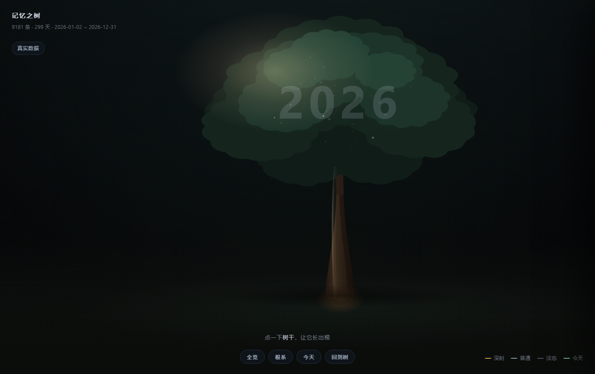
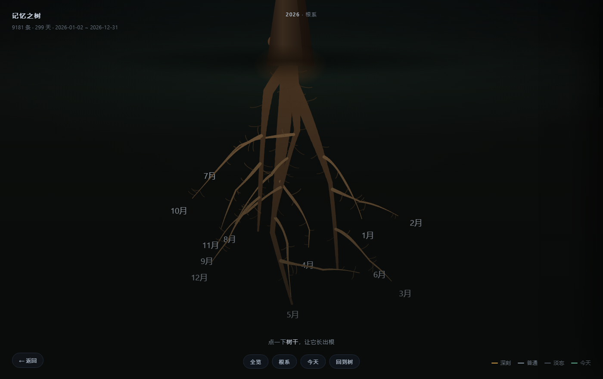

# dsh-memory-tree

**English** ｜ [中文](README.zh-CN.md)

A memory for [DeepSeek Harness](https://github.com/deepseek-ai) that you can *see*.

It reads the session logs DSH already writes, turns them into a local SQLite memory,
lets unimportant days fade with time, and renders the whole thing as a tree you can
drill into: **year → month → week → day**.

Everything stays on your machine. No server, no API calls, no model in the pipeline.



## What it actually does

| Layer | What happens |
|---|---|
| **Collect** | Scans `~/.dsh/sessions/**/*.jsonl.zstd`, decompresses the multi-frame zstd, keeps user / assistant / tool events, drops system injections. Incremental: unchanged files are skipped. |
| **Index** | One index per day (term → which days), plus day / week / month cards. Retrieval answers "which days" first, then reads text from those days only. |
| **Fade** | Every day gets a salience score (how much you talked, how often the topic recurs, milestones, facts). Deep / normal / faint by percentile. Old originals move to cold storage; only faint days are ever deleted, and every eviction is recorded. |
| **Digest** | A ten-line summary written into `~/.dsh/AGENTS.md`, which DSH loads into every new session automatically. |
| **Tree** | The page: a root system where the trunk is the year, the four thick roots are groups of months, and each month branches into weeks and days. Deep days glow gold, faint days dim. Click a day to read what was said. |

## Requirements

- DeepSeek Harness with third-party plugin support (Profile / bundle system).
- **Node.js ≥ 22.5** — the memory uses the built-in `node:sqlite`.

No native modules, no build step, no `pnpm install` beyond what the plugin manager does.

## Install

Install the bundle from this directory with the plugin manager — or, inside a running
Harness, just ask the agent to install the bundle at that path. Nothing needs to be
built or downloaded.

A **Memory tree** chip appears next to the session title; it opens the page in the
centre panel.

On first use the plugin creates `~/.dsh/memory`, seeds three config files, and runs one
collection pass in the background. The page reloads itself when the first tree is ready.

Already have a memory database somewhere else? Set `memoryDir` (see below) before the
first run — otherwise the plugin starts a fresh one in the default location.

## Configuration

Pass as the bundle's `config:` in the profile patch:

```yaml
- id: dsh-memory-tree
  name: dsh-memory-tree
  config:
    memoryDir: ~/.dsh/memory   # where the database, cards and page live
    refreshMinutes: 15         # 0 turns the timer off
    digest: true               # write the ten-line digest into ~/.dsh/AGENTS.md
    sessionsDir: ~/.dsh/sessions  # only if your DSH stores logs elsewhere
```

`memoryDir` is seeded once with `profile.json` (your identity and rules, hand-edited),
`decay.json` (half-lives and retention) and `sources.json` (session patterns to exclude).
Nothing is overwritten after the first run.

## The page



- Click the trunk → the root system grows.
- The panel toolbar has **← Back to chat**, **Refresh**, and **New window**. Refresh runs a
  collection pass immediately instead of waiting for the timer, then reloads the page.
- Click a month → its weeks branch out; click a week → its days.
- Click a day → the right panel shows the keywords, the sessions, and what you and the
  assistant actually said.
- Small lights travel from the root tips up to the trunk: that is the memory being
  pulled up, not data.
- **Deep / normal / faint** days are coloured gold / grey-blue / dark; deep days carry a ★.
- `?demo=1` (or the button under the title) switches to a frozen 12-month sample, so the
  page can be shown without exposing a real memory.
- **List view**: the button under *Demo* swaps the tree for a flat day-by-day overview —
  stats, open threads, facts, then every day as one collapsible row. Same data, no tree.
  Direct link: `#LV`.
- Hash routes for direct links: `#L1` roots, `#L2` weeks, `#L3` days, `#V` overview,
  `#T` today.

## Command line

The same database has a CLI, useful when you want the agent to answer precisely:

```bash
node src/query.mjs status                 # events, span, last collection
node src/query.mjs find "手柄"             # which days mentioned it, then the原文
node src/query.mjs day 2026-10-24         # everything from one day
node src/query.mjs remember "周五前交初稿"  # store a fact
node src/query.mjs context "帮我看下齿轮"   # one line, or nothing if irrelevant
```

Set `DSH_MEMORY_DIR` if the database is not at the default location.

## Privacy

- Everything is local: SQLite file, HTML page, log file.
- The only file outside `memoryDir` that is written is `~/.dsh/AGENTS.md`, and only the
  block between `<!-- MEMORY:AUTO:BEGIN -->` and `<!-- MEMORY:AUTO:END -->`.
  Set `digest: false` to stop that entirely.
- Nothing is sent anywhere. The pipeline contains no network calls.

## Uninstall

Remove the bundle in the plugin manager, then delete `~/.dsh/memory` (that is the whole
memory) and the `MEMORY:AUTO` block in `~/.dsh/AGENTS.md` if you want it gone from new
sessions too.

## Known limits

- `node:sqlite` is still experimental; the scripts pass `--no-warnings` to keep it quiet.
- Retrieval is keyword matching (Chinese character bigrams + English words) with a
  co-occurrence fallback. There are no embeddings, and no "last week" style date parsing.
- Week and month cards are mechanical summaries, not model-written ones.
- Collection runs on a timer, so the newest session is up to `refreshMinutes` behind.
- The tree is a single SVG; a decade of daily data will eventually need virtualisation.

## License

MIT — see [LICENSE](LICENSE).
